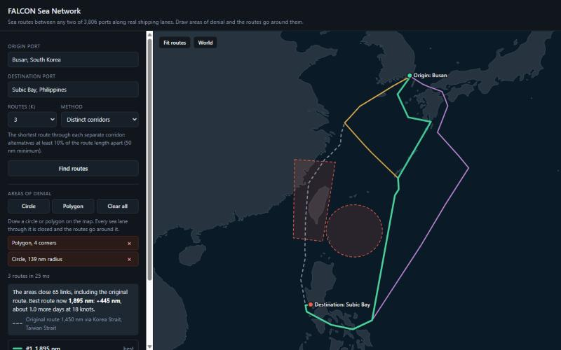
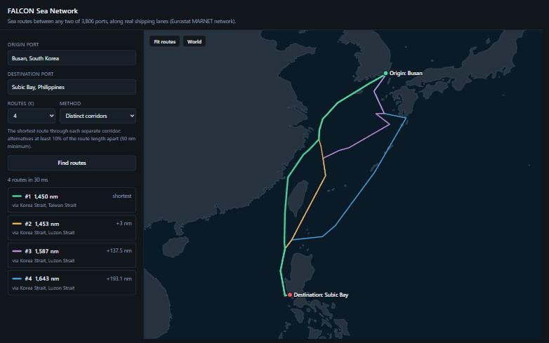

# FALCON Sea Network

Sea routes between any two of 3,806 ports, along real shipping lanes, with K
alternative routes. Draw areas of denial (circles or polygons) and the routes
find their way around them. It contains a worldwide port and shipping-lane
data model for Neo4j, plus a small map to show it working.



## Run it

Needs Python 3.8 or later and nothing else (standard library only).

```bash
python server.py
```

Then open http://localhost:8100.

1. Type or pick an origin port and a destination port, choose K (1 to 5) and a
   method, and select **Find routes**.
2. Under **Areas of denial**, choose **Circle** (press and drag) or **Polygon**
   (click the corners, then double-click or press Enter). Routes recompute as
   soon as an area is finished.
3. Draw as many areas as you like; remove one with its ×, or **Clear all**.

The mouse wheel zooms and dragging pans. Routes take milliseconds.

## Areas of denial

Every link whose real path enters an area is closed, and the search runs on
what is left. Routes bend around the area rather than losing whole port-to-port
lanes, because the closure applies to stretches of water, not to lanes between
ports.

- **A circle** is a true circle on the globe. Its radius is in nautical miles,
  measured along the earth's surface.
- **A polygon's sides** are straight in latitude and longitude, which is exactly
  how they look on this map.
- **Every stretch of a lane is tested,** at most 10 nm apart, plus an exact check
  on each straight piece, so even a 3 nm circle catches a lane passing through it.
- **A port inside an area is closed.** If the origin or destination is inside,
  the result says so.
- **The map shows the original route dashed in grey,** next to the new routes,
  with the extra distance. Extra days use a nominal 18 knots, for a rough sense
  only.

| Busan to Subic Bay | Best route | Via |
|---|---|---|
| No areas | 1,450 nm | Korea Strait, Taiwan Strait |
| Polygon over the Taiwan Strait | 1,453 nm | Korea Strait, Luzon Strait |
| That polygon, plus a 239 nm circle over the Luzon Strait | 1,969 nm | Korea Strait, San Bernardino Strait |
| 239 nm circle over the Luzon Strait only | 1,450 nm (unchanged) | The original route never goes near Luzon |

## How routing works

The data does not store port-to-port lanes. It stores the **shipping-lane
network itself**: 4,525 sea junctions joined by 9,686 lane segments, built from
Eurostat's MARNET maritime network. Each port is linked to the lane beside it.
A route is the shortest path through that network, so any port can reach any
other, and every route follows real water around land and through real straits.

Ports are only a route's start and end, never a stop in between.

### Two ways to get K routes

| Method | What you get | When to use it |
|---|---|---|
| **Yen's K shortest** | The exact 1st, 2nd, ... Kth shortest routes | When you need the true ranking |
| **Distinct corridors** | The shortest route through each separate stretch of water | When you need alternatives a planner would recognise |

On a mesh of shipping lanes, Yen's algorithm finds thousands of nearly identical
routes, the same track nudged a few miles around one junction. Busan to Subic Bay
with K=3 gives 1,449.6, 1,450.0 and 1,450.9 nm, all through the Taiwan Strait,
drawn on top of each other.

Distinct corridors uses the via-point method. It works out the shortest distance
from the origin to every point in the network, and from every point to the
destination. With those two, the best route through any point X is known at once.
Points are taken cheapest first, and a route is kept only if X lies at least 10%
of the route's length (50 nm minimum) from every route already kept. Routes that
detour out and back are rejected. Each kept route is the shortest route through
its own waters.

| Busan to Subic Bay | Yen's K shortest | Distinct corridors |
|---|---|---|
| #1 | 1,450 nm, Taiwan Strait | 1,450 nm, Taiwan Strait |
| #2 | 1,450 nm, Taiwan Strait | 1,453 nm, Luzon Strait, east of Taiwan |
| #3 | 1,451 nm, Taiwan Strait | 1,587 nm, Luzon Strait, across the East China Sea |
| #4 | 1,451 nm, Taiwan Strait | 1,643 nm, Luzon Strait, east of the Ryukyu Islands |



Both methods respect areas of denial.

## Scenario tests

`scenarios/` holds test scenarios, one JSON file each: an origin, a
destination, any areas of denial, and what the answer should be. One command
runs them all and writes a report with two map snapshots per scenario, the whole
route and a close-up of the areas of denial (or the destination).

```bash
python run_scenarios.py
```

| Scenario | Move | What it shows |
|---|---|---|
| S01 | San Diego to Subic Bay | Basic logic: across the Pacific and into the Philippines through the San Bernardino Strait, 6,733 nm |
| S02 | The same, with a 150 nm area of denial over the San Bernardino Strait | The route moves to the Luzon Strait, 6,768 nm (+35 nm) |
| S03 | Yokosuka to Singapore, with the Luzon Strait denied | The route moves from east of Taiwan to the Taiwan Strait, 2,977 nm (+26 nm) |
| S04 | Guam to Manila, with the Luzon and San Bernardino Straits both denied | The route goes south, in through the Surigao Strait and up through the Mindoro Strait, 1,864 nm (+165 nm) |
| S05 | Honolulu to Kao-Hsiung, with an area of denial around all of Taiwan | No route is possible, because the destination is inside the area, and the report says so |

Each run writes a new report to `reports/<date>_<time>/`, for example
`reports/2026-10-29_151023/`, and the report shows the same time with its
time zone. Reports are kept in the repository, so every run has a record:

- `report.html` is one file with the maps inside, ready to send as it is.
- `results.json` holds the same results for other tools.
- `snapshots/` holds each map as SVG, plus PNG when Edge or Chrome is installed.

Each report compares the best route with the previous run's, so a change
in the data or the routing shows up. The command exits with 1 if any check
fails, so it can run in CI. To add a scenario, copy a file in `scenarios/`;
[scenarios/README.md](scenarios/README.md) lists every field and expectation.

## API

`server.py` answers two requests:

- `GET /api/ports` returns every port: `id`, `name`, `country`, `lat`, `lon`, `size`.
- `POST /api/routes` takes a JSON body and returns the routes:

```json
{
  "from": "WPI-60390",
  "to": "WPI-58395",
  "k": 3,
  "method": "distinct",
  "areas": [
    {"type": "circle", "center": [124.2, 22.43], "radius_nm": 239},
    {"type": "polygon", "points": [[118.5, 26.5], [121.8, 25.6], [121.0, 21.8], [119.0, 22.2]]}
  ]
}
```

Points are `[longitude, latitude]`. The response holds `original` (the best route
with no areas), `routes` (ranked, each with `length_nm`, `passages` and the
`line` to draw), `closed_links`, whether the areas `affected` the original
route, `extra_nm`, and `blocked` with a reason when no route is possible.

## What's here

| Path | What it is |
|---|---|
| `neo4j-datamodel/` | The data, ready to load into Neo4j. Start with `START_HERE.md`. |
| `sea_routing.py` | Shortest path (A*), Yen's K shortest, and distinct corridors |
| `server.py` | A small web server for the map |
| `web/` | The map page, with d3-geo and the Natural Earth coastline |
| `run_scenarios.py` | Runs the scenarios, checks the answers, writes the report |
| `map_snapshot.py` | Draws a scenario's map as SVG (and PNG) |
| `scenarios/` | The test scenarios, one JSON file each |

To use the data in Neo4j instead, follow `neo4j-datamodel/START_HERE.md`.
`neo4j-datamodel/ASSUMPTIONS.md` lists every filter, default and known gap.

## Data sources and licences

| Data | Source | Licence |
|---|---|---|
| Ports | [NGA World Port Index (Pub 150)](https://msi.nga.mil/Publications/WPI) | U.S. government public data |
| Airfields and runways | [OurAirports](https://ourairports.com/data/) | Public domain |
| Shipping-lane network | [Eurostat searoute, MARNET network](https://github.com/eurostat/searoute), via [searoute-ts](https://github.com/mayurrawte/searoute-ts) | [EUPL-1.2](https://spdx.org/licenses/EUPL-1.2.html) |
| Coastline (map only) | [Natural Earth](https://www.naturalearthdata.com/) 1:50m land | Public domain |
| Map libraries | [d3-geo, d3-array](https://d3js.org/), [topojson-client](https://github.com/topojson/topojson-client) | ISC |

The sea network files in `neo4j-datamodel/` (`sea_nodes.csv`,
`sea_segments.csv` and the lane shapes in the port link files) are derived from
the Eurostat MARNET network and remain under EUPL-1.2.
